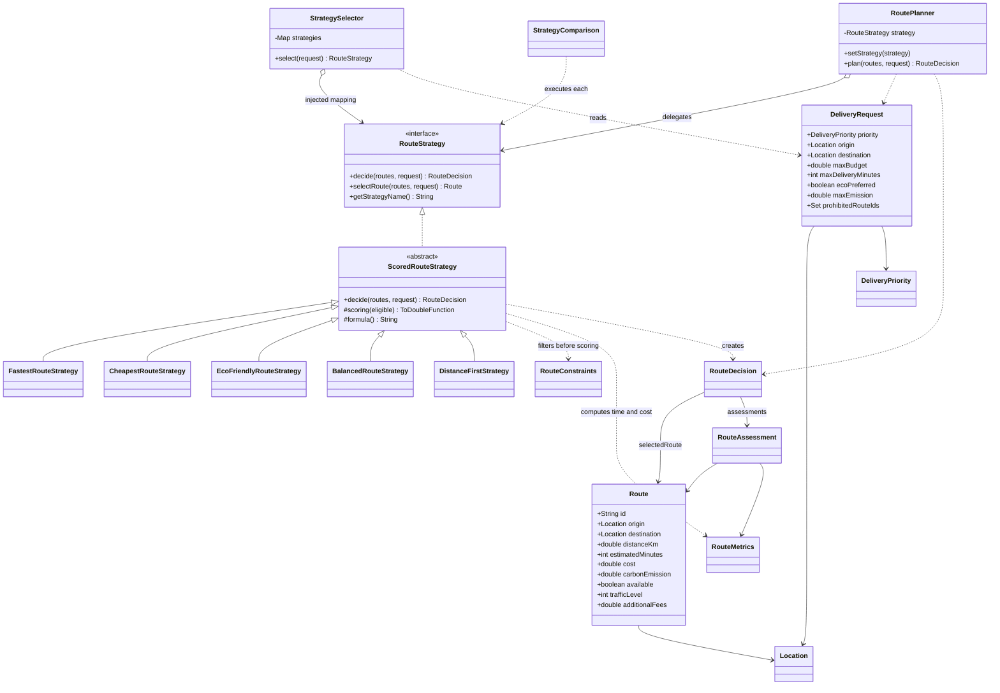
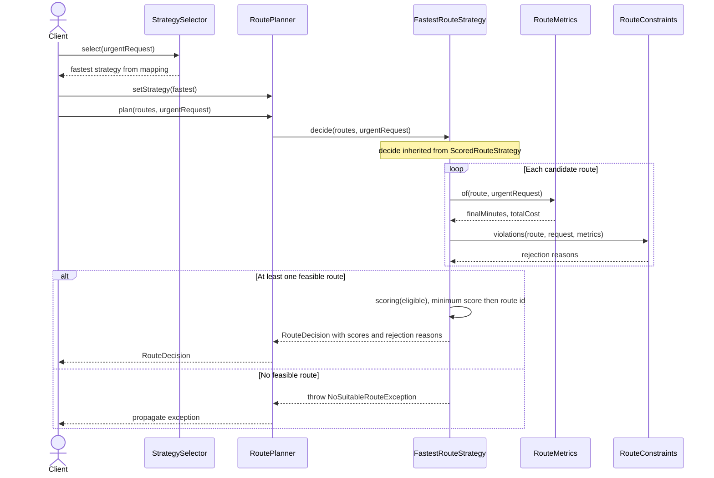

# Assignment 5 — Smart Delivery & Route Optimization Engine

Автор: Sanzhar Karaulov. Java 17+, Maven, JUnit 5.

## Запуск

Нужны JDK 17 или новее и Maven 3. Для первого запуска Maven скачивает зависимости.

```bash
cd /Users/33karaulov/IdeaProjects/SDP-AS-5
mvn clean verify
mvn exec:java
```

В IntelliJ IDEA откройте `pom.xml` как Maven-проект, выберите JDK 17+ и запустите `delivery.Main`. Тесты находятся в `src/test/java/delivery/RouteEngineTest.java`.

Приложение запускает готовую демонстрацию без ввода: восемь маршрутов, три переключения одного планировщика, автоматический выбор для разных запросов, сравнение пяти стратегий и три ожидаемые ошибки. Эти ошибки перехватываются, программа завершается нормально.

## Архитектура и Strategy

Проблема: один набор маршрутов имеет разных победителей в зависимости от цели доставки. Strategy позволяет заменить алгоритм выбора во время работы, сохранив клиентский код планирования.

- **Context:** `planner/RoutePlanner` хранит `RouteStrategy` и делегирует `plan()` → `decide()`. В нём нет `instanceof`, переключателей по имени и формул алгоритмов.
- **Strategy:** `strategy/RouteStrategy`. Сохранены `selectRoute()` и `getStrategyName()` из задания; добавлен `decide()`, который возвращает маршрут вместе с объяснением. `selectRoute()` — удобный default-метод поверх `decide()`.
- **Concrete Strategies:** FastestRouteStrategy, CheapestRouteStrategy, EcoFriendlyRouteStrategy, BalancedRouteStrategy, DistanceFirstStrategy.
- **Общий процесс:** `ScoredRouteStrategy` проверяет входные данные, рассчитывает показатели, отбрасывает недопустимые маршруты, выбирает минимальный балл и формирует объяснение. Это дополнительное применение Template Method внутри семейства стратегий.
- **Selector:** `selector/StrategySelector` выбирает объект стратегии из переданной карты. Он решает, **какой алгоритм применять**, а стратегия решает, **какой маршрут выбрать**.
- **Comparison:** `planner/StrategyComparison` выполняет стратегии на одном запросе, возвращает отдельный результат или объяснение отсутствия маршрута для каждой.

Данные — неизменяемые records: Location, Route, DeliveryRequest, RouteMetrics, RouteAssessment и RouteDecision. Коллекции в запросе и результатах копируются. Все кандидаты должны иметь уникальный id; равные баллы разрешаются лексикографически по id, независимо от порядка списка.

## Формулы и ограничения

Деньги указаны в KZT, расстояние в km, время в min, выбросы в kg CO2. Коэффициенты учебные, а не реальные тарифы или модель дорожного движения.

```text
finalTime = estimatedMinutes + trafficLevel × 3
subtotal = baseCost + distanceKm × 50 + additionalFees
totalCost = subtotal × (URGENT ? 1.25 : 1.0)
```

`trafficLevel` лежит в диапазоне 0..5. Тариф и время вынесены в RouteMetrics, чтобы бюджет, дедлайн, сравнение и алгоритмы использовали одинаковые значения. Cheapest минимизирует итоговую стоимость, включая расстояние, сборы и надбавку.

| Стратегия | Минимизируемый балл |
|---|---|
| Fastest | Итоговое время с пробками |
| Cheapest | Итоговая стоимость |
| EcoFriendly | CO2 × 0.8 + distance × 0.2 |
| Balanced | Сумма нормализованных критериев с весами |
| DistanceFirst | Расстояние |

Экологическая формула находится в EcoFriendly, потому что определяет именно экологическую политику ранжирования. Это условный составной балл, не физическая величина CO2.

Balanced использует время, итоговую стоимость, расстояние и выбросы. Для каждого критерия:

```text
normalized = (value - min) / (max - min)
score = timeWeight × normalizedTime
      + costWeight × normalizedCost
      + distanceWeight × normalizedDistance
      + emissionWeight × normalizedEmission
```

Минимум и максимум берутся **только среди допустимых маршрутов**. Если `max == min`, вклад равен нулю: этот критерий не различает кандидатов. Веса должны быть конечными, от 0 до 1, их сумма — 1 с допуском 1e-9. По умолчанию в Main: 0.40, 0.30, 0.10, 0.20.

Перед ранжированием каждая из пяти стратегий отклоняет маршрут, если он недоступен, не соответствует исходной/конечной точке, превышает бюджет, срок или лимит выбросов, либо его id запрещён. Равенство лимиту разрешено. Совпадение точек определяется равенством Location record, включая имя и координаты.

Пустой список и отсутствие допустимых кандидатов вызывают NoSuitableRouteException с причиной. Отрицательные и неконечные числовые данные, неверные веса и дубли id вызывают IllegalArgumentException. Отсутствующие обязательные объекты отклоняются явно (NullPointerException через requireNonNull / copyOf).

## Автоматический выбор и переключение

Карта в Main задаёт URGENT → Fastest, ECONOMY → Cheapest, ECO → EcoFriendly, STANDARD → Balanced. Если STANDARD имеет `ecoPreferred=true`, выбирается EcoFriendly. Явные URGENT/ECONOMY/ECO имеют приоритет над этой дополнительной настройкой.

Main создаёт один RoutePlanner и выполняет Fastest → Cheapest → EcoFriendly → Balanced: это **три замены во время одного запуска**. Для пятой стратегии не нужен новый приоритет: она доступна непосредственно и в сравнении. Карта селектора позволяет подставить её для существующего приоритета без изменения самого селектора.

## Пример реального вывода

```text
Fastest -> B | time 20 min | cost 3700.00 KZT | score 20.0000
Cheapest -> D | time 45 min | cost 1600.00 KZT | score 1600.0000
Eco-friendly -> C | time 43 min | cost 1800.00 KZT | score 2.8800
Balanced -> G | time 28 min | cost 2400.00 KZT | score 0.3252
Distance-first -> E | time 36 min | cost 2200.00 KZT | score 8.0000
```

Полный сохранённый запуск: [docs/demo-output.txt](docs/demo-output.txt). Для стандартного запроса F отвергается как недоступный, H — из-за бюджета. При URGENT с бюджетом 10000 и сроком 30 минут Fastest выбирает H; итоговая стоимость с надбавкой — 9375. Баллы разных стратегий имеют разные масштабы: сравнивать число `20` у Fastest с `0.3252` у Balanced напрямую нельзя.

## Проверки

`mvn clean verify`: **38 запусков JUnit, 0 failures, 0 errors, 0 skipped**. 26 тестовых методов, включая три параметризованных теста по пяти стратегиям. Проверяются формулы и конкретные победители, изменение весов, исключение недопустимых кандидатов из нормализации, постоянные критерии, все ограничения для каждой стратегии, бюджет, пробки и срок, точные границы, три переключения, селектор и его приоритеты, сравнение, отсутствие решений, невалидные данные, дубли id, равные баллы и защитное копирование.

Проверено 30 октября 2026 на macOS с Maven 3.9.16 и JDK 25.0.1, компиляция с `--release 17`. Это проверяет целевой API/байткод Java 17; запуск именно на JDK 17 отдельно не выполнялся. Отчёты создаются в `target/surefire-reports/`.

## UML Class Diagram



## UML Sequence Diagram



Исходники диаграмм: [class-diagram.mmd](docs/class-diagram.mmd), [sequence-diagram.mmd](docs/sequence-diagram.mmd). GitHub отображает Mermaid в README.

## SOLID, расширение и отличие от Bridge

**SRP:** RoutePlanner делегирует, StrategySelector выбирает политику, конкретная стратегия определяет балл, RouteConstraints проверяет допустимость, RouteMetrics рассчитывает общие показатели.

**OCP:** DistanceFirstStrategy добавлена отдельным коммитом после работающего приложения с четырьмя стратегиями. Из существующего кода изменена только регистрация в списке сравнения Main; RoutePlanner, RouteStrategy и StrategySelector не изменялись. Новая политика ранжирования требует наследника ScoredRouteStrategy с названием, формулой и функцией балла. Можно также реализовать RouteStrategy напрямую, но тогда соблюдение ограничений и объяснение — ответственность новой реализации.

**DIP:** RoutePlanner зависит от RouteStrategy, конкретный объект получает извне через конструктор или setter. Selector также принимает карту абстракций.

Это Strategy, потому что алгоритмы взаимозаменяемы через единый интерфейс, а Context не выбирает реализацию ветвлениями. Небольшое бизнес-условие в Selector или расчёте надбавки не заменяет архитектуру цепочкой if/else.

**Strategy vs Bridge:** Strategy меняет алгоритм выполнения одной задачи. Bridge разделяет две независимо изменяемые иерархии, например тип уведомления и канал доставки из предыдущего задания. Наличие композиции в обоих паттернах не делает их назначение одинаковым.

## Ограничения решения

Программа выбирает из готовых маршрутов, а не строит пути по графу и не решает задачу нескольких машин/заказов. Нет сетевых API, реальных пробок, базы данных и интерактивного меню. Balanced зависит от текущего множества кандидатов; добавление допустимого маршрута может изменить нормализацию и победителя. Денежные значения используют double: для реальных расчётов нужны BigDecimal и правила округления. Mutable RoutePlanner предназначен для последовательного использования, не для совместной работы потоков. Объяснения предназначены для учебной консоли.

## Git и сдача

История разделена на небольшие коммиты по модели, общему контракту, алгоритмам, Context/Selector, демонстрации, пятой стратегии, тестам и документации. Просмотр: `git log --oneline --reverse`.

Настроенный origin: https://github.com/unsaiddream/SDP-AS-5.git. Коммиты подготовлены локально; публикация и доступность публичного репозитория не проверены, Moodle не отправлен. После проверки можно опубликовать `git push -u origin main` и передать ссылку на публичный репозиторий вместе с README в Moodle согласно заданию.

Памятка для индивидуальной защиты и live modification: [docs/DEFENSE_RU.md](docs/DEFENSE_RU.md).
